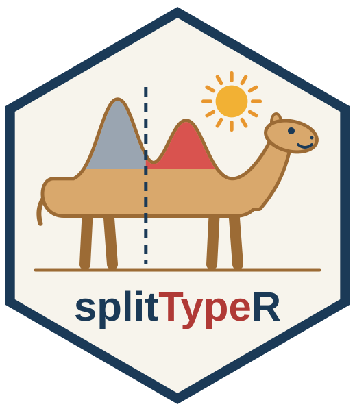

# splitTypeR logo



Logo of the [splitTypeR](https://github.com/adeschen/splitTypeR) R package,
which classifies bulk transcriptomic samples using gene signatures and a
mixture of two normal distributions.

## Design

The camel's back is drawn from a mixture of two normal distributions, the
model used by splitTypeR to classify the samples:

* the grey hump represents the "low-mean" distribution;
* the red hump represents the "high-mean" distribution;
* the dashed line is the classification threshold (the 95th percentile of
  the "low-mean" distribution).

## Files

| File | Description |
|------|-------------|
| `logo.svg` | Logo, vector format |
| `logo.png` | Logo, 518 x 600 pixels, transparent background |
| `make_logo_camel.R` | R script drawing the logo (`logo.svg` and `logo.png`) |
| `make_name_outline.py` | Python script converting the package name into vector outlines |
| `name_outline.svgfrag` | Outlines of the package name, used by `make_logo_camel.R` |
| `LICENSE.md` | License of the logo |

## Regenerating the logo

```bash
# Only needed when the name (text, color, size or position) changes
python3 make_name_outline.py /path/to/Arimo-Bold.ttf

# Writes logo.svg and logo.png
Rscript make_logo_camel.R
```

The first command requires the Python
[fontTools](https://github.com/fonttools/fonttools) library and the
[Arimo Bold](https://fonts.google.com/specimen/Arimo) font. The second
command requires R; the PNG file is created when the
[magick](https://cran.r-project.org/package=magick) package is installed.

## License

The splitTypeR logo is licensed under the
[Creative Commons Attribution 4.0 International License (CC BY 4.0)](https://creativecommons.org/licenses/by/4.0/).
The package name is drawn with the Arimo Bold font (Apache License 2.0).
See [LICENSE.md](LICENSE.md) for details.

The logo was designed by Astrid Deschênes with the assistance of Claude
(Anthropic) through Claude Code.
